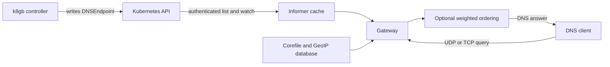

# Architecture

`k8s_crd` is a CoreDNS plugin that serves external DNS answers from Kubernetes
DNSEndpoint resources. k8gb's controller writes the desired endpoints; this
plugin observes them and answers DNS requests. It does not proxy application
traffic. It is intended to run separately from cluster-internal DNS.

## Code map and data flow

| Component | Implementation and contract |
| --- | --- |
| CoreDNS entry point and configuration | [cmd/coredns.go](cmd/coredns.go) links CoreDNS plugins; [setup.go](setup.go) parses the `k8s_crd` Corefile block and registers the gateway and optional weighted ordering |
| Kubernetes authentication | [configfactory.go](configfactory.go) uses in-cluster credentials by default, or `KUBECONFIG` with `kubecontroller local` |
| Resource acquisition | [extdns](extdns) and [common/k8sctrl/ctrl.go](common/k8sctrl/ctrl.go) list and watch `externaldns.k8s.io/v1alpha1` DNSEndpoints across namespaces with configured label filters |
| Request handling | [k8scrd.go](k8scrd.go) checks informer synchronization and dispatches to [service/container.go](service/container.go) |
| DNS responses | [service/gateway](service/gateway) handles configured zones, A and TXT records, zone-apex SOA/NS answers, and negative answers; the protocol is DNS over UDP/TCP |
| GeoIP selection | [common/netutils](common/netutils) extracts EDNS Client Subnet; [common/k8sctrl/ep.go](common/k8sctrl/ep.go) selects targets from a local MaxMind database using configured field paths |
| Weighted ordering | [service/wrr](service/wrr) uses endpoint labels to reorder address answers when enabled |
| Deployment and verification | [charts/coredns](charts/coredns), [Dockerfile](Dockerfile), and [terratest](terratest) define the example deployment, nonroot container, and integration tests |

## External interfaces and trust boundaries

Administrators control the Corefile, mounted GeoIP database, service account,
network exposure, and image version. See [README.md](README.md) for options and
[terratest/example](terratest/example) for DNSEndpoint examples. The plugin reads
`spec.endpoints[].dnsName`, `targets`, `recordTTL`, and labels. Kubernetes RBAC
must restrict who can write these resources: those writers control published DNS
answers. Label filters select resources and do not replace authorization.

DNS clients are untrusted. The plugin uses the EDNS Client Subnet value, falling
back to the transport peer address, to select GeoIP answers. Client-supplied
subnets are routing hints, not authenticated identities or an access-control
boundary. Unsupported query types can return no data. The plugin does not
authenticate application clients or authorize their access to returned targets.

Kubernetes API credentials and their TLS trust configuration belong to the
deployment. Restrict the service account to the resources and verbs needed for
list/watch. The implementation watches across namespaces; a restrictive label
filter does not reduce the API permissions granted to the service account.
GeoIP files and configuration are trusted deployment inputs and must not be
writable by untrusted clients. Missing or invalid GeoIP data can interrupt
resolution; it is an availability dependency.

Container image publication, release tags, third-party dependencies, and CI
workflow changes form the software supply chain boundary. See [DEPENDENCY.md](DEPENDENCY.md)
and [SECURITY.md](SECURITY.md). The
[k8gb self-assessment](https://github.com/k8gb-io/k8gb/blob/master/self-assessment.md)
provides the project-wide threat and security context, including this embedded
CoreDNS component. This document does not assert that all deployment hardening
recommendations are enforced by the example chart.
